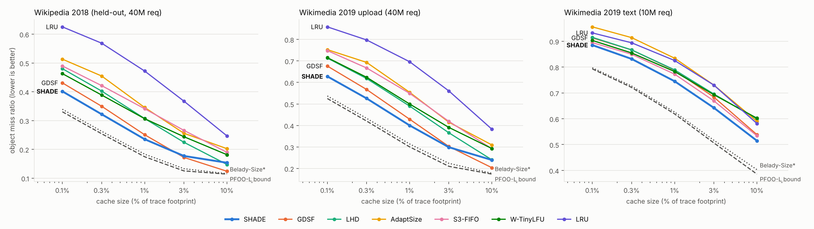
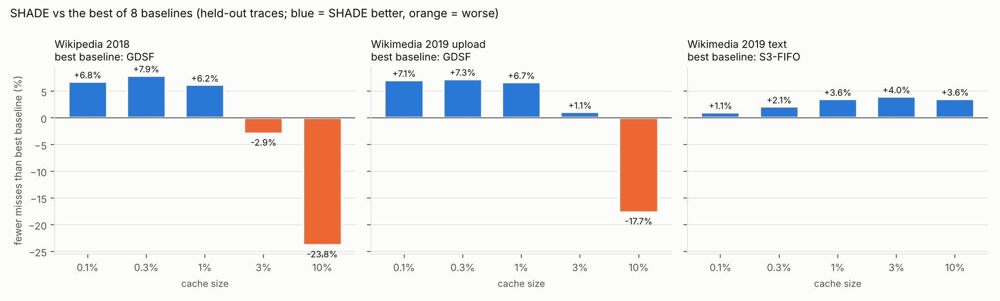

# CDN_optimizer: knapsack-dual caching for CDN edge servers

**Which objects should a CDN edge server keep, and which new ones are worth storing at all?**
This project answers with **SHADE** (Shadow-price Admission and hit-Density Eviction), a caching policy derived
from the knapsack formulation of caching. It is evaluated on **90 million real requests** from Wikipedia's and
Wikimedia's CDN against eight published policies, under a protocol that froze the method before any test data was used.

### Results on held-out real traces

Object miss ratio (lower is better), SHADE vs the **best** of eight baselines at each cache size. Cache size is a share
of the trace footprint. Full tables, byte miss ratios and ablations: [`docs/LAB_RESULTS.md`](docs/LAB_RESULTS.md).

| Trace (held-out) | 0.1% | 0.3% | 1% | 3% | 10% |
|---|---:|---:|---:|---:|---:|
| Wikipedia 2018, 40M requests (best baseline: GDSF) | **−6.8%** | **−7.9%** | **−6.2%** | +2.9% | +23.8% |
| Wikimedia 2019 upload, 40M requests (GDSF) | **−7.1%** | **−7.3%** | **−6.7%** | **−1.1%** | +17.7% |
| Wikimedia 2019 text, 10M requests (S3-FIFO) | **−1.1%** | **−2.1%** | **−3.6%** | **−4.0%** | **−3.6%** |

Negative = SHADE has that many fewer misses than the best baseline; positive = more.

* SHADE beats all eight baselines in **12 of 15** held-out settings. It has **6–8% fewer misses than GDSF** at small and
  medium caches on both media traces, and wins at every size on the text trace.
* **It loses at large caches (10%, and 3% on one trace), where GDSF is better.** This weakness was already visible on
  the development slice; we report it rather than retune on test data.
* Compared with LRU, SHADE removes 5–52% of misses (mean 30% over all held-out settings).
* The byte-objective variant SHADE-B beats the best baseline (S3-FIFO) on byte miss ratio in 10 of 15 settings, but
  only by 0.3–1.9%. That result is modest.



## The idea in one paragraph

Offline, caching is a **knapsack over reuse intervals**. Keeping an object between two consecutive requests earns one hit
and costs `size × gap` of cache space-time. The fractional relaxation, solved by the DAA greedy rule, gives the
PFOO-L bound (Berger et al. 2018), and LP duality says the optimum keeps exactly the intervals whose hits per
space-time beat a single **shadow price**. SHADE makes that online. It learns reuse-time distributions from all recent
requests, cached or not, using Kaplan–Meier censoring, exponential forgetting and empirical-Bayes shrinkage. It ranks
objects by an **optimal-stopping index** (best hits per byte per unit time over any holding time). It evicts the lowest
index and **admits a new object only if it wins the knapsack exchange test** against the objects it would displace.
Details, derivation and an honest list of what is borrowed: [`docs/METHOD.md`](docs/METHOD.md).

## How the evaluation was kept honest

1. **Real data only.** Three public traces from two years and two Wikimedia clusters:

   | Trace | Requests | Objects | Footprint | Requested once |
   |---|---:|---:|---:|---:|
   | Wikipedia 2018 (LRB paper), requests 10M–50M | 40M | 4.5M | 503 GB | 55% |
   | Wikimedia 2019 upload (media), day 1 | 40M | 6.9M | 610 GB | 53% |
   | Wikimedia 2019 text (HTML), day 1 | 10.2M | 3.7M | 89 GB | 68% |

2. **Development vs test split.** Every design choice, and SHADE's single tuned constant (exchange margin = 2), was
   decided on a separate **development slice** (Wikipedia 2018, requests 0–10M).
3. **Frozen before testing.** The method was committed (`Add cache lab and SHADE (frozen before held-out evaluation)`)
   before any run on the held-out traces. Nothing was changed afterwards.
4. **Strong, faithful baselines**, all reimplemented in the same simulator: LRU, FIFO, SIEVE (NSDI'24), S3-FIFO (SOSP'23),
   GDSF, W-TinyLFU, AdaptSize (NSDI'17) and LHD (NSDI'18, ported from the authors' MIT-licensed code).
5. **A true upper bound.** The PFOO-L bound and an offline Belady-Size reference show how much room is left.
6. **Tests.** 460 checks, including: no policy ever exceeds capacity, no policy hits on a first request, and no policy,
   offline references included, ever beats the PFOO-L bound.



## Reproduce

Requirements: CMake ≥ 3.16, a C++17 compiler, Python 3 + matplotlib; Node ≥ 18 for the dashboard.

```bash
make lab-test                    # build the cache lab and run its tests
```

```bash
make traces TRACES=traces        # download and convert the 3 public traces (~3 GB)
```

```bash
make heldout TRACES=traces       # full evaluation -> results/lab/*.json (~1.5 h on 4 cores)
```

```bash
make lab-figures                 # docs/LAB_RESULTS.md and docs/figures/lab_*.png
```

Run any policy on any trace:

```bash
lab/build/cachelab run traces/w19u.bin --sizes 0.001,0.01,0.1 --policies GDSF,LHD,SHADE
```

## Dashboard

```bash
make dashboard && make serve     # http://127.0.0.1:8787
```

*Real-trace results* (curves, rankings, the per-setting comparison, ablations), *How SHADE works*, *Knapsack solvers*,
an animated *DP visualizer*, and the earlier *Simulation study (v1)*.

## How the project got here

The first version of this project (still in `core/`, see [`docs/REPORT.md`](docs/REPORT.md)) planned the cache by solving
an exact knapsack every epoch on forecast popularity (PACK-DP). It beat every baseline on synthetic traffic, 150 of 150
paired tests. On real Wikipedia traffic it came **fourth of six**: real CDN traffic is dominated by objects requested only
once, and prefetching planned contents wasted bandwidth. Real data also exposed a stack-overflow bug in the recursive
branch-and-bound solver, which is now iterative. Those two lessons, *learn from real request streams* and *admission
matters as much as eviction*, are what SHADE is built on.

The DAA toolkit from v1 is still here and still used: 9 knapsack solvers (2-D DP, rolling DP, Hirschberg-style
O(n + C)-space DP that needs 159 KB where the table needs 512 MB, Martello–Toth branch and bound, meet-in-the-middle,
FPTAS, greedy variants), a multiple-choice knapsack for multi-bitrate video, and their tests (`make build test`).

## Repository layout

```
lab/             cache lab: trace format, 9 policies + SHADE, PFOO-L bound, runner, tests, experiment scripts
core/            v1: knapsack solvers, synthetic workloads, PACK-DP planner, experiment matrix
dashboard/       React dashboard (reads results/*.json and results/lab/*.json)
results/lab/     real-trace results (JSON)        results/  v1 results
docs/            METHOD.md (SHADE), LAB_RESULTS.md (tables), REPORT.md (v1 report), figures/
scripts/         lab_figures.py, v1 figure/summary scripts
```

## Limitations

* Simulation only, on traces from one operator (Wikimedia); time is logical (request count), as in the LHD and PFOO papers.
* SHADE loses to GDSF at large cache sizes.
* No comparison with learned policies (LRB, GL-Cache); no production deployment.
* SHADE keeps reuse statistics for every object seen in the last 2^23 requests: more metadata than LRU or S3-FIFO.

## License

MIT. LHD port: MIT, © 2017–2018 Carnegie Mellon University.
