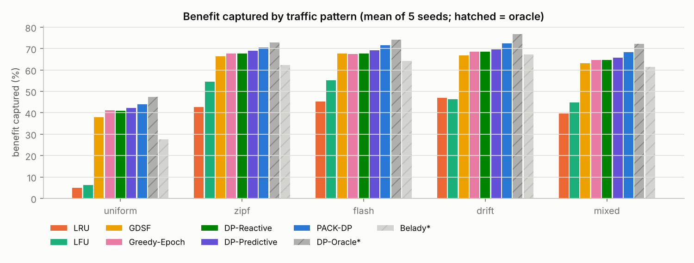

# CDN_optimizer: knapsack DP for edge-cache replacement

**Which objects should a CDN edge server keep?** This project treats the question as a **0/1 knapsack problem**
(object = item, size = weight, value = expected benefit B = f·(α·cost + β·latency)) and builds a full Design &
Analysis of Algorithms study around it:

* a **C++17 engine** with 9 knapsack solvers, 8 cache policies, 5 realistic workloads, real-trace replay and an 11-experiment matrix;
* **PACK-DP** (Predictive, Adaptive, Churn-aware Knapsack), a new planner. It combines a Hedge-ensemble forecaster
  and a Poisson burst detector with an exact knapsack solver, and is **the best deployable policy on every workload tested**;
* a **React dashboard** (8 pages, including a live simulator and an animated DP table) and a **report** with proofs.

### Results at a glance

Mean of 5 seeds, cache = 5% of a 34 GB catalog, 600k requests per run. Full tables are in [`docs/RESULTS.md`](docs/RESULTS.md).

| Benefit captured (%) | uniform | zipf | flash | drift | mixed |
|---|---:|---:|---:|---:|---:|
| LRU | 4.9 | 42.6 | 45.2 | 46.9 | 39.8 |
| GDSF (Squid) | 38.1 | 66.3 | 67.7 | 66.9 | 63.1 |
| DP-Reactive (exact KP on last epoch) | 41.1 | 67.6 | 67.6 | 68.5 | 64.7 |
| DP-Predictive (exact KP on Holt forecast) | 42.2 | 69.0 | 69.1 | 69.5 | 65.8 |
| **PACK-DP (this project)** | **44.1** | **70.5** | **71.6** | **72.4** | **68.3** |
| *DP-Oracle\* (knows the future)* | *47.4* | *72.8* | *74.2* | *76.8* | *72.3* |

* **150/150** paired wins against every deployable baseline (same trace, per seed). +1.5 to +2.8 pts over the strongest baseline, +25 to +39 over LRU.
* On mixed traffic, compared with LRU: **hit ratio 82.0% vs 42.7%**, **latency 22 ms vs 63 ms**, **origin $ saved 49.6% vs 36.3%**.
* Hirschberg-style DP solves the same Θ(nC) knapsack in **159 KB instead of 512 MB**.
* Greedy is near-optimal in big caches, but up to **12.5% off in tiny ones**, where the exact DP pulls ahead.
* For multi-bitrate video, the **multiple-choice knapsack** has the highest hit ratio at every cache size and the highest benefit up to 10%.



---

## What's inside

| Area | Highlights |
|---|---|
| **Exact DP** | 2-D table · 1-D rolling DP with bit-packed keep table · **Hirschberg-style divide & conquer in O(n + C) space** (same Θ(nC) time; < 200 KB where the 2-D table needs 512 MB) |
| **Exact search** | Branch & bound with the **Martello–Toth U2** bound (capacity-independent) · **meet-in-the-middle** for capacities around 10¹⁰ |
| **Approximation** | **FPTAS** (profit scaling with LB = modified greedy, O(n²/ε)) · greedy · modified greedy (≥ OPT/2) · Dantzig LP bound |
| **Variants** | **Multiple-choice knapsack** for multi-bitrate video (cache at most one rendition per title, transcode down) |
| **Cache policies** | LRU · O(1) LFU (frequency-node lists) · GDSF · size-aware Belady\* · DP-Oracle\* · Greedy-Epoch · DP-Reactive · DP-Predictive (Holt) · **PACK-DP** |
| **Workloads** | Uniform · Zipf · flash crowds · popularity drift with content lifecycles · *mixed* (drift + flash + crawler scans) · **CSV trace replay** |
| **Rigor** | prefetches charged as origin traffic · identical traces for every policy · 5 seeds + **paired statistics** · parameters tuned on held-out seeds · oracles labelled `*` · 20 unit tests (~590k assertions) |

## Quick start

Requirements: CMake ≥ 3.16 and a C++17 compiler. Optional: Node ≥ 18 for the dashboard, Python 3 + matplotlib for figures.

```bash
make build test              # build the engine and run the unit tests
```

```bash
./core/build/cdnopt run --pattern mixed --algos all
```

```bash
./core/build/cdnopt solve --n 2000 --cap 8192      # compare the knapsack solvers on one instance
```

```bash
make experiments             # full experiment matrix -> results/*.json (~5 min on 4 cores)
```

```bash
make serve                   # dashboard + live simulation API on http://127.0.0.1:8787
```

Replay a real access log (`object_id,size_kb` or `timestamp,object_id,size_kb`):

```bash
python3 scripts/make_sample_trace.py && ./core/build/cdnopt run --trace experiments/traces/sample_trace.csv --algos all
```

## How PACK-DP works

```
every epoch                                   every epochLen/10 requests
───────────                                   ──────────────────────────
f̂  ← Hedge mix of 4 forecasters                burst test per object (Poisson z-test):
      (last, slow EWMA, fast EWMA, damped Holt)  k_i > μ_i + 3√μ_i + 2 ?
      weights ∝ exp(−η · discounted loss)       excess ≥ 2% of traffic → boost f̂_i, re-plan
B_i ← f̂_i·(α·c_i + β·l_i) − γ·[not cached]·α·c_i
plan ← exact knapsack (B&B on real bytes; unit DP fallback) + slack fill
diff  → prefetch new objects (charged), evict dropped ones
```

The design follows a measured finding. On real cache instances the **optimisation gap** (greedy vs exact)
is small at normal sizes, while the **forecast gap** (DP on last epoch vs DP on the truth) is several points. So PACK-DP spends its effort on prediction and adaptation.
The ablation confirms it: removing the forecaster or the burst detector costs the most.

## Dashboard

`make serve`, then open http://127.0.0.1:8787. For a static deploy, `.github/workflows/pages.yml` publishes it to GitHub Pages.

| Page | Shows |
|---|---|
| Overview | ranked comparison per workload and metric, paired win table, headline tiles |
| Timeline | per-epoch series with flash/scan bands, the knapsack plan log, cache composition |
| Sweeps | cache size, Zipf skew, flash intensity, epoch length, α/β Pareto frontier, DP resolution, empirical competitive ratio |
| Ablation | what each PACK-DP component contributes |
| DAA lab | solver scaling (time and memory, log-log), hard instances, MITM, FPTAS ε trade-off, optimality gaps, complexity table |
| Multi-bitrate (MCKP) | multiple-choice knapsack vs independent / top-version / LRU |
| DP visualizer | animated `dp[i][c]` fill with dependencies and backtracking, editable items, greedy comparison |
| Live lab | configure a scenario; the C++ engine runs it through the API |

## Repository layout

```
core/            C++ engine: include/cdn/*.hpp, src/*.cpp, apps/cdnopt.cpp, tests/
dashboard/       React + Recharts dashboard (reads results/*.json)
server/          zero-dependency Node bridge (static files + /api/simulate)
results/         experiment outputs (JSON), committed so the dashboard works out of the box
docs/            REPORT.md (analysis + proofs), RESULTS.md (generated tables), ARCHITECTURE.md, figures/
scripts/         make_figures.py, summarize.py, make_sample_trace.py
experiments/     run_all.sh, traces/
```

## Documentation

* [`docs/REPORT.md`](docs/REPORT.md): the DAA report (formulation, algorithms with proofs, complexity, methodology, results, discussion).
* [`docs/RESULTS.md`](docs/RESULTS.md): every result table, generated from `results/*.json`.
* [`docs/ARCHITECTURE.md`](docs/ARCHITECTURE.md): system design, data formats, deviations from the original brief.
* [`docs/ORIGINAL_DESIGN.md`](docs/ORIGINAL_DESIGN.md): the original design document this project started from.

## License

MIT
