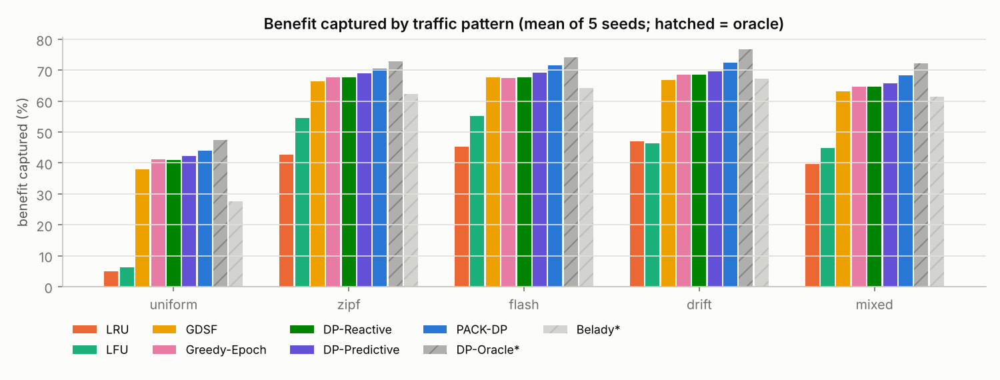
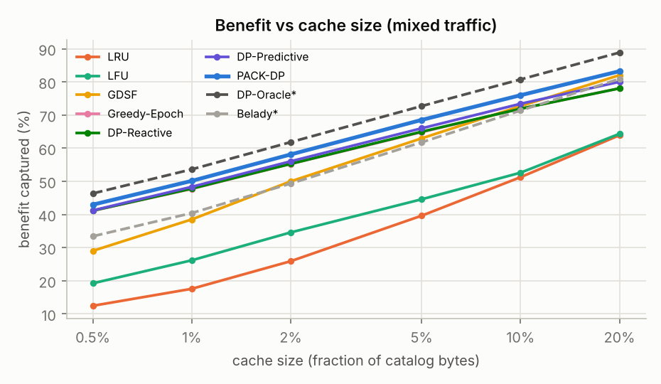
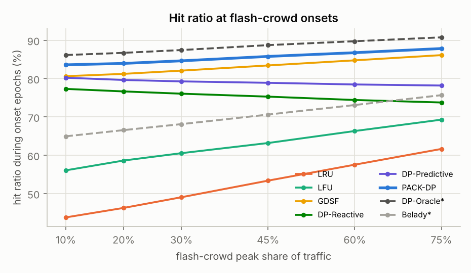
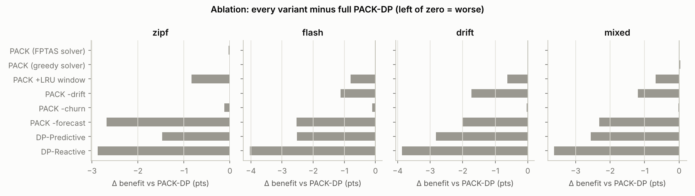
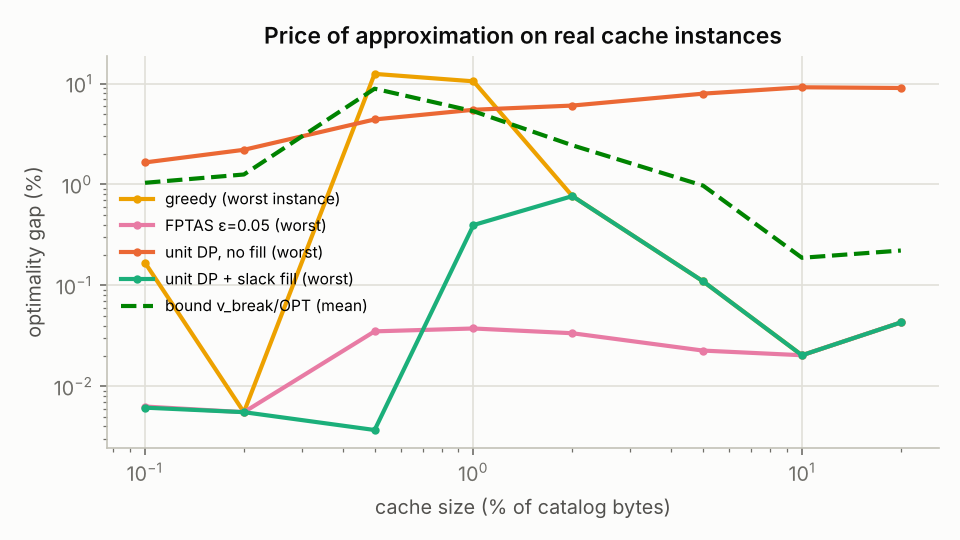
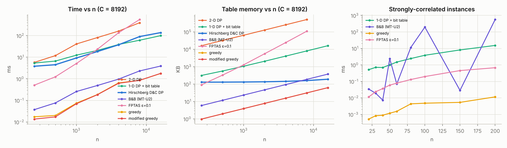
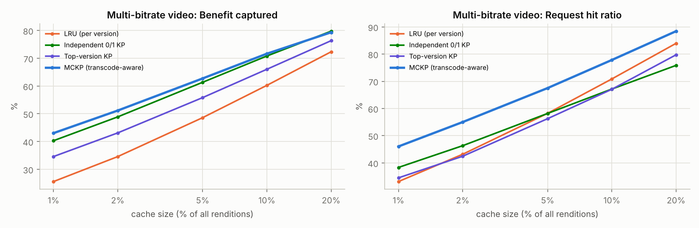

# CDN Cache Optimizer: Knapsack Dynamic Programming vs. Online Cache Replacement

**Course:** Design and Analysis of Algorithms. **Artifacts:** C++17 engine (`core/`), React dashboard (`dashboard/`),
experiment data (`results/`), figures (`docs/figures/`), full result tables ([`RESULTS.md`](RESULTS.md)).

---

## Abstract

A CDN edge server must decide which of millions of objects to keep in a small cache. We formulate the decision
as a **0/1 knapsack** per epoch: item = object, weight = size, value = expected benefit
B<sub>i</sub> = f<sub>i</sub>·(α·c<sub>i</sub> + β·l<sub>i</sub>), where f is request frequency, c is origin cost and l is miss latency.
We implement and analyse nine knapsack solvers (three exact DPs with different space bounds, including an
O(n + C)-space **Hirschberg-style divide-and-conquer DP**; branch-and-bound with the Martello–Toth bound;
meet-in-the-middle; an FPTAS; greedy and modified greedy), plus a **multiple-choice knapsack DP** for
multi-bitrate video. We compare epoch planners built on them against LRU, O(1) LFU, GDSF and two oracles
(hindsight DP and size-aware Belady) on five workloads.

Measured on real cache instances, the gap between greedy and exact knapsack solutions is small at
normal cache sizes but reaches double digits in tiny caches. It is still dominated by the **forecast error**: an exact DP on
last epoch's counts loses ~4–8 points of benefit to the same DP on true counts. We therefore propose **PACK-DP**
(Predictive, Adaptive, Churn-aware Knapsack). It combines a regret-bounded **Hedge ensemble of forecasters**, a
**Poisson z-test burst detector** that triggers mid-epoch re-optimisation, and an admission (churn) penalty.
PACK-DP is the best deployable policy on every workload, every cache size and every skew we tested, and wins
**150/150** paired comparisons against deployable baselines (+1.5 to +2.8 points over the strongest, +25 to +39 over LRU; see [§7](#7-results)).

---

## 1. Problem definition and motivation

An edge server with capacity C serves requests for a catalog of n objects. Object i has size s<sub>i</sub>, origin
fetch cost c<sub>i</sub> ($ of egress per miss), miss latency l<sub>i</sub> (origin time-to-first-byte), and a time-varying
request rate f<sub>i</sub>(t). A hit avoids both the dollars and the latency. Popularity is heavily skewed (Zipf),
drifts (content lifecycles), spikes (flash crowds), and is polluted by one-hit wonders (crawlers).

Classic replacement policies (LRU, LFU) decide per request using recency or frequency only: they ignore size,
cost and latency. The question this project answers: **how much better can an edge cache do by solving the
underlying combinatorial problem explicitly, and where does the remaining loss come from?**

## 2. Formal formulation

Divide time into epochs. For epoch e choose S ⊆ {1..n}:

```
maximise   Σ_{i∈S} B_i            B_i = f̂_i · (α·c_i/c̄ + β·l_i/l̄) − γ·[i ∉ cache]·α·c_i/c̄
subject to Σ_{i∈S} s_i ≤ C
```

c̄ and l̄ normalise the two terms, so α and β are unit-free. The last term (PACK-DP only) charges an object that
is not yet at the edge for the origin fetch its admission causes. This is the 0/1 knapsack problem with items =
objects. The decision version is NP-complete (reduction from SUBSET-SUM with v<sub>i</sub> = w<sub>i</sub>), so we
expect only pseudo-polynomial exact algorithms, exponential-time exact search, or approximation schemes, and
we implement all three families.

**Evaluation metric.** The headline metric is **benefit captured** = Σ<sub>hits</sub> B / Σ<sub>requests</sub> B, which is
exactly what the knapsack maximises. Request hit ratio, byte hit ratio, origin dollars saved (net of prefetch
traffic), mean latency and per-request CPU cost are reported for every run.

## 3. Algorithms

### 3.1 Exact dynamic programming

`dp[i][c]` = best value using items 1..i with capacity c.

```
dp[0][c] = 0
dp[i][c] = max( dp[i-1][c],  dp[i-1][c - s_i] + B_i )      (second term only if s_i ≤ c)
```

**Optimality (optimal substructure).** Let S* be optimal for (i, c). If i ∉ S*, S* is feasible for (i−1, c), and
any better solution there would also be better for (i, c); so value(S*) = dp[i−1][c]. If i ∈ S*, then S* \ {i} must be
optimal for (i−1, c−s<sub>i</sub>) by the same exchange argument. The recurrence takes the max over both cases. By
induction on i, dp[n][C] = OPT. **Time Θ(nC)**: one O(1) update per cell. That is pseudo-polynomial, because C is a
number whose encoding has only log C bits.

We implement three space variants:

| Variant | Space | Reconstruction |
|---|---|---|
| `dp2d`: full table | Θ(nC) doubles | compare dp[i][c] with dp[i−1][c] backwards |
| `rolling`: 1-D array, capacity loop runs **downward** so dp[c−s<sub>i</sub>] still holds row i−1 | Θ(C) doubles + n·C **bits** | a bit table `keep[i][c]` records whether item i was taken |
| `hirschberg`: divide and conquer | **Θ(n + C)** | recursion (below) |

**Hirschberg-style knapsack (O(n + C) space, O(nC) time).** Split the items into halves L and R. Run the rolling DP
over L and over R separately to get F<sub>L</sub>[c] and F<sub>R</sub>[c] (best value with capacity ≤ c), each in O(C) space.
OPT = max<sub>c</sub> F<sub>L</sub>[c] + F<sub>R</sub>[C−c]. Let c* be the argmax. Free both arrays, then recurse on (L, c*) and (R, C−c*).

*Correctness:* any solution splits into a part from L using some c ≤ C and a part from R using ≤ C−c. Both parts are
at most F<sub>L</sub>[c] and F<sub>R</sub>[C−c], and the recursion achieves them exactly.
*Time:* at depth d there are 2<sup>d</sup> sub-problems with n/2<sup>d</sup> items each, and their capacities sum to C
(each split partitions its capacity). Level d therefore costs Σ (n/2<sup>d</sup>)·C<sub>j</sub> = nC/2<sup>d</sup>, and summing over
levels gives ≤ 2nC = **O(nC)**. *Space:* only one pair of O(C) arrays is alive at a time, plus O(log n) stack
frames, so **O(n + C)**. Measured: at C = 8192 the 2-D table needs 512 MB at n = 8000, while Hirschberg needs < 200 KB at
every n, for the same running time (Fig. `solvers.png`).

### 3.2 Branch and bound (Martello–Toth U2 bound)

Sort items by density v/w. Do a depth-first search that tries "include" before "exclude", starting from the greedy
solution as the incumbent. At a node with residual capacity r, let j be the break item (first item that doesn't fit).
Two bounds apply: U0 = prefix + r·d<sub>j+1</sub> (item j excluded) and U1 = prefix + v<sub>j</sub> − (w<sub>j</sub> − r)·d<sub>j−1</sub>
(item j forced in, which removes a fractional part of the least-dense included item). U2 = max(U0, U1) is a valid upper
bound and is never weaker than the LP (Dantzig) bound, because each case is an LP relaxation restricted to one branch on x<sub>j</sub>.
Prefix sums plus binary search make each bound O(log n). B&B is **independent of C**, so it runs on exact byte sizes.
Its worst case is exponential. On Pisinger's strongly-correlated instances (v = w + R/10) it explored
1.66·10<sup>7</sup> nodes at n = 100 and hit our 5·10<sup>7</sup> cap at n = 200, where the DP needed 15 ms.

### 3.3 Meet-in-the-middle

Enumerate all subsets of each half (2<sup>n/2</sup>), sort one side by weight with prefix maxima of value, and binary search
for each subset of the other side. Time O(2<sup>n/2</sup>·n), independent of C. It solves n = 40 items with weights up to
10<sup>9</sup> bytes in 0.56 s, a case where a DP table would need ~10<sup>10</sup> columns.

### 3.4 Approximation

**Greedy by density** has no constant-factor guarantee (counter-example: items (1, 2) and (C, C) give 2 vs C).
It still satisfies **OPT − greedy ≤ v<sub>b</sub>**, where b is the break item: OPT ≤ Dantzig bound ≤ prefix + v<sub>b</sub> ≤
greedy + v<sub>b</sub>. This explains why greedy is near-optimal when no single object is valuable relative to the cache's
total value. **Modified greedy** = max(greedy, best single item) ≥ OPT/2, since greedy-prefix + v<sub>b</sub> ≥ OPT and
the larger of the two terms is ≥ OPT/2.

**FPTAS (profit scaling).** Let LB = modified greedy (so OPT/2 ≤ LB ≤ OPT), K = ε·LB/n, p<sub>i</sub> = ⌊v<sub>i</sub>/K⌋. Run the
DP over *profit*: minW[q] = minimum weight reaching scaled profit q. Every feasible set has scaled profit ≤ OPT/K ≤
2n/ε, so the table has O(n/ε) columns and the time is **O(n²/ε), independent of C**. The scaled optimum S′ satisfies
v(S′) ≥ K·p(S′) ≥ K·p(S*) ≥ Σ<sub>S*</sub>(v<sub>i</sub> − K) ≥ OPT − nK = OPT − ε·LB ≥ **(1−ε)·OPT**. (Using LB in K
gives O(n²/ε) instead of the textbook O(n³/ε).) Measured gaps are 10–1000× below the guarantee.

### 3.5 Multiple-choice knapsack for multi-bitrate video

An ABR title exists in renditions 240p…2160p. An edge can transcode *down* from a cached higher rendition, so
caching rendition j serves requests for all q ≤ j. Treating renditions as independent 0/1 items double-counts. The
right model is the MCKP: for each title pick **at most one** rendition, with value
V<sub>ij</sub> = Σ<sub>q≤j</sub> f<sub>iq</sub>·B<sub>iq</sub>·(1 if q = j else τ), where τ = 0.85 is the transcode factor.

```
dp_g[c] = max( dp_{g-1}[c],  max_j dp_{g-1}[c − s_gj] + V_gj )
```

Time O(C·Σ|g|) and space O(C) plus a G×C table of 16-bit choices for reconstruction.

### 3.6 Online and oracle baselines

* **LRU:** hash map + doubly linked list, O(1). Its competitive ratio vs an optimal offline cache of size h ≤ k is
  k/(k−h+1) (Sleator & Tarjan 1985). It is size- and cost-blind.
* **LFU:** the O(1) structure of Shah et al. (2010): a list of frequency nodes, each holding an LRU list of objects.
* **GDSF** (Greedy-Dual-Size-Frequency, Cherkasova 1998; used by Squid): priority L + f·B/s, evict the minimum,
  and set L to the evicted priority (aging). O(log k).
* **Belady\*** (oracle): evict the object whose next request is furthest in the future, and bypass objects never
  requested again or needed later than everything they would displace. Optimal for unit sizes, which our tests
  verify by exhaustive search. For variable sizes it is a strong reference, not an upper bound.
* **DP-Oracle\*** (oracle): the exact knapsack on each epoch's *true* counts. It is the best possible static plan
  per epoch, and the yardstick for how much forecasting costs.

### 3.7 PACK-DP: Predictive, Adaptive, Churn-aware Knapsack

A planner is "solve a knapsack on a forecast". Its loss against DP-Oracle* splits into a **price of approximation**
(solver gap) and a **price of uncertainty** (forecast gap). The data shows the second dominates (§7.4), so PACK-DP
spends its effort there.

1. **Hedge ensemble forecaster.** Four experts predict f<sub>i</sub> for the next epoch: last epoch, slow EWMA (α = 0.25),
   fast EWMA (α = 0.6), and damped Holt (α = 0.5, β = 0.3, φ = 0.8). After each epoch, each expert's loss is the
   benefit-weighted L1 error Σ<sub>i</sub> B<sub>i</sub>|f̂<sub>i</sub> − y<sub>i</sub>| / Σ<sub>i</sub> B<sub>i</sub>y<sub>i</sub>. Weights follow multiplicative weights
   with discounting: L<sub>k</sub> ← 0.7·L<sub>k</sub> + loss<sub>k</sub>, w<sub>k</sub> ∝ exp(−η·L<sub>k</sub>), η = 4. Undiscounted Hedge has regret
   O(√(T ln K)) against the best expert in hindsight (Freund & Schapire 1997). Discounting trades part of that
   guarantee for tracking regime changes (stationary Zipf favours slow EWMA; drift favours fast EWMA or Holt).
2. **Burst detector → mid-epoch re-plan.** Every epochLen/10 requests, object i should have received
   μ<sub>i</sub> = f̂<sub>i</sub>·(interval/epochLen) requests. Under a Poisson model, k<sub>i</sub> > μ<sub>i</sub> + 3√μ<sub>i</sub> + 2 (with k<sub>i</sub> ≥ 4) flags an
   emerging heavy hitter. If the flagged excess is ≥ 2% of the interval's traffic, PACK-DP re-solves the knapsack
   with f̂<sub>i</sub> ← max(f̂<sub>i</sub>, observed rate), at most 3 times per epoch. Cost: O(touched objects) per check. A
   miss-ratio CUSUM detector was tried first and rejected: its false alarms on stationary traffic and noisy re-plan
   inputs made results *worse*.
3. **Churn penalty γ = 2.** An object that is not cached must earn its admission fetch.
4. **Exact solver on real sizes.** B&B on byte sizes (node cap 4·10<sup>5</sup>). If B&B does not prove optimality, PACK-DP
   also runs the rolling DP on 4096 capacity units and keeps the better plan after an exact-byte slack fill.
   Core pruning keeps only the densest candidates up to 4·C bytes (Balas–Zemel core).
5. **Cold start:** before its first plan the whole cache runs LRU, and the first plan promotes those objects for free.

**Per-epoch complexity:** O(n·E) forecasting with E = 4 experts, plus one knapsack solve per (re-)plan, plus O(1) per request.

## 4. Complexity summary

| Algorithm | Time | Space | Guarantee |
|---|---|---|---|
| 2-D DP | Θ(nC) | Θ(nC) | exact |
| Rolling DP + bit table | Θ(nC) | Θ(C) words + nC bits | exact |
| Hirschberg D&C DP | Θ(nC) (≤ 2nC) | Θ(n + C) | exact |
| B&B (MT-U2) | O(2ⁿ) worst | O(n) | exact (node cap) |
| Meet-in-the-middle | O(2<sup>n/2</sup> n) | O(2<sup>n/2</sup>) | exact |
| FPTAS | O(n²/ε) | O(n²/ε) bits | ≥ (1−ε)·OPT |
| Greedy / modified greedy | O(n log n) | O(n) | none / ≥ OPT/2 |
| MCKP DP | O(C·Σ\|g\|) | O(C + G·C) | exact |
| LRU / LFU / GDSF | O(1) / O(1) / O(log k) per request | O(k) | heuristic |
| Alias sampler (workload) | O(n) build, O(1) per sample | O(n) | exact distribution |

Empirical log-log slopes from `solvers.json` (time vs n at fixed C) are 0.7–1.2 for the DPs (linear in n as Θ(nC)
predicts, with constant overheads visible at small n) and 2.09 for the FPTAS (O(n²/ε)).

## 5. Implementation

* **C++17, no external dependencies.** CMake, one static library + CLI + test binary. About 4,600 lines in `core/`.
* Every policy implements `ICacheStrategy`, and the engine replays **one shared trace** through all of them in parallel threads.
* **Workload generator:** Vose alias sampling with popularity re-evaluated 10× per epoch, head-rank churn, content
  lifecycles (x·e<sup>1−x</sup> popularity curves), flash crowds on cold objects (ramp, then exponential decay), and sequential
  crawler scans. Real access logs can be replayed with `--trace file.csv`.
* **Catalog:** 60% static assets (log-normal around 60 KB), 32% video segments (~2.5 MB), 8% large files (~60 MB).
  Four origin tiers from $0.02 to $0.25/GB and 35 to 260 ms TTFB.
* **Tests (20 cases, ~590k assertions):** every exact solver equals brute force on 600 random instances; Hirschberg =
  rolling = B&B on large instances; FPTAS ≥ (1−ε)·OPT for four values of ε; modified greedy ≥ OPT/2; LP bound ≥ OPT;
  MITM at C = 7·10⁹; MCKP = brute force; Belady optimal for unit sizes (exhaustive search); **every strategy never
  exceeds capacity and every reported hit was really cached**; alias sampler χ-style check; determinism.

## 6. Experimental methodology

* **Same trace for every algorithm** (generated once per seed). Seeds change the catalog *and* the trace.
* **Prefetches are charged:** a planner that admits an object proactively pays its origin bytes and dollars.
* **Warm-up:** the first 2 epochs are excluded from every summary.
* **Statistics:** 5 seeds for head-to-head and ablation, 2–3 for sweeps. Because seeds differ in catalog, we also report
  **paired differences** (same seed, PACK-DP minus baseline) and win counts.
* **No tuning on test seeds:** PACK-DP's parameters were chosen on held-out seeds 101–102. Evaluation uses seeds 1–5.
* **Oracles are labelled `*`** and never counted as "best".
* Experiment matrix: head-to-head × 5 patterns; capacity (0.5–20%); Zipf skew (0.5–1.4); flash intensity (10–75%);
  epoch length (2.5k–80k requests); α/β weights; DP resolution (128–16384 units); ablation; solver benchmarks; optimality
  gaps; multi-bitrate MCKP.

## 7. Results

Full tables are in [`RESULTS.md`](RESULTS.md), which is generated from `results/*.json`. The figures are in `docs/figures/`.
Every number below can be reproduced with `make experiments && python3 scripts/summarize.py`.

### 7.1 Head-to-head (5 workloads × 5 seeds, cache = 5%)



| Benefit captured (%) | uniform | zipf | flash | drift | mixed |
|---|---:|---:|---:|---:|---:|
| LRU | 4.92 | 42.59 | 45.23 | 46.92 | 39.75 |
| LFU | 6.21 | 54.62 | 55.27 | 46.42 | 44.75 |
| GDSF | 38.05 | 66.34 | 67.71 | 66.86 | 63.08 |
| Greedy-Epoch | 41.10 | 67.64 | 67.57 | 68.50 | 64.63 |
| DP-Reactive | 41.05 | 67.64 | 67.59 | 68.50 | 64.72 |
| DP-Predictive | 42.18 | 69.04 | 69.11 | 69.54 | 65.78 |
| **PACK-DP** | **44.08** | **70.52** | **71.63** | **72.37** | **68.34** |
| DP-Oracle\* | 47.44 | 72.81 | 74.21 | 76.78 | 72.32 |
| Belady\* | 27.62 | 62.24 | 64.21 | 67.20 | 61.43 |

**Paired test.** PACK-DP beats every deployable baseline on every seed of every workload: **150/150 paired
comparisons**. Its margin over the strongest baseline (DP-Predictive) is +1.47 ± 0.36 (zipf) to +2.82 ± 0.43 (drift)
points, over GDSF +3.9 to +6.0, and over LRU +25 to +39. Across workloads PACK-DP closes 36–49% of the gap between
the best baseline and DP-Oracle\*.

On mixed traffic PACK-DP also leads every deployable policy on the operational metrics: request hit ratio 82.0% (LRU 42.7%,
GDSF 78.3%), mean latency 22.0 ms (LRU 63.3 ms), origin dollars saved 49.6% (LRU 36.3%, GDSF 42.6%) and byte hit
ratio 42.2%. Its per-request cost is 45 ns, plus 1.35 s of total planning time over 600k requests (≈ 2.2 µs amortised per request).

### 7.2 Sweeps



* **Cache size:** PACK-DP is best at every size from 0.5% to 20%. The value-aware advantage is largest in small caches:
  at 0.5% of the catalog PACK-DP captures 43.0% vs GDSF 29.0% and LRU 12.4% (mixed). On Zipf at 0.5%, exact
  **DP-Reactive beats Greedy-Epoch by 1.7 points** (40.1 vs 38.4). That is exactly where §7.4 shows greedy's
  optimality gap is large.
* **Skew:** PACK-DP leads for every Zipf exponent from 0.5 to 1.4 (49.2% → 92.4%). The gap to LRU shrinks as skew grows,
  because a tiny head then fits in any cache.
* **Flash crowds:** hit ratio during onset epochs *rises* with burst intensity for PACK-DP (83.6% → 87.8%) and *falls*
  for DP-Reactive (77.3% → 73.8%). The burst detector turns a bigger burst into a clearer signal. GDSF (80.6–86.1%)
  adapts per request and is the strongest baseline here.
* **Epoch length:** short epochs make plans fresher but forecasts noisier. Every causal planner peaks around 10k
  requests per epoch (the oracle prefers short epochs, since it has no forecast noise). PACK-DP is best at every length, and its planning time falls from 4.8 s to 0.4 s as epochs grow.
* **α/β:** moving α from 0 to 1 trades request hit ratio (87.8% → 53.9% for PACK-DP) for byte hit ratio (23.4% → 49.4%).
  That is a Pareto frontier the operator chooses on. LRU sits at one fixed point.
* **DP resolution:** outcomes are flat from 128 to 16384 capacity units, because the exact-byte slack fill recovers what
  rounding loses. A coarse C (fast O(nC)) is enough in the simulator.



### 7.3 Ablation



| Δ benefit vs full PACK-DP (pts) | zipf | flash | drift | mixed |
|---|---:|---:|---:|---:|
| without Hedge forecaster | −2.68 | −2.54 | −2.01 | −2.31 |
| without burst detector | −0.00 | −1.12 | −1.74 | −1.19 |
| without churn penalty | −0.12 | −0.10 | −0.03 | −0.02 |
| with a 10% LRU window | −0.83 | −0.80 | −0.62 | −0.68 |
| greedy solver instead of exact | −0.01 | +0.01 | +0.01 | +0.04 |
| FPTAS (ε = 0.05) instead of exact | −0.03 | +0.01 | −0.01 | −0.00 |

The forecaster is the largest contributor everywhere. The burst detector matters only when there are bursts or drift;
on stationary Zipf it never fires, which shows the detector produces no false alarms. The churn penalty is marginal. The
W-TinyLFU-style window hurts, so it is not part of PACK-DP. At 5% cache the solver choice makes no measurable
difference, which motivates the next section.

### 7.4 Price of approximation vs price of uncertainty



On 12 real cache instances (true counts of a Zipf epoch, ~3,300 objects, exact byte sizes), measured against the best
known solution (certified within 0.46% of the true optimum by the LP bound):

* **Greedy:** mean gap ≤ 0.02% for caches ≥ 5%, but **2.8% mean / 12.5% worst** at 0.5% and 1.6% / 10.5% at 1%.
  The provable bound v<sub>break</sub>/OPT peaks in the same range (8.9% at 0.5%).
* **Unit DP without slack fill** loses 1.5–7.8% to size rounding. **With the fill** it is within 0.16% on average.
* **FPTAS (ε = 0.05):** ≤ 0.04% worst case everywhere, so its guarantee is loose by ~100×.

Compare: the forecast gap (DP-Reactive → DP-Oracle\*) is **4–8 points** of captured benefit. Prediction, not
optimisation, is the bottleneck at realistic cache sizes, and both matter in tiny caches.

### 7.5 Solver benchmarks



* At C = 8192 the three exact DPs have the same Θ(nC) growth. Memory at n = 8000: 2-D table **512 MB**, rolling +
  bitset **8 MB**, Hirschberg **159 KB**. At n = 16000 the 2-D table no longer fits our 700 MB budget, while Hirschberg
  needs 191 KB.
* Log-log slopes of time vs n: DPs 0.7–1.2 (linear, with constant overhead visible at small n); FPTAS 2.09 (O(n²/ε)).
  Against C: B&B 0.06 and FPTAS −0.19, so both are capacity-independent as claimed.
* **Strongly-correlated instances:** B&B node counts are erratic and explode (1.66·10<sup>7</sup> nodes at n = 100; the
  5·10<sup>7</sup> cap at n = 200, 564 ms), while the DP's time grows smoothly (15 ms at n = 200). Greedy is up to 7.4% off there.
* **Meet-in-the-middle** at C ≈ 10<sup>10</sup>: n = 40 in 563 ms and 57 MB, where a DP table is impossible. Time grows ×~4.7 per
  4 extra items (≈ √2 per item), as 2<sup>n/2</sup> predicts.
* **FPTAS:** halving ε roughly doubles time (2.3 ms at ε = 0.5 → 304 ms at ε = 0.01). Observed gaps on hard instances are
  1.06% at ε = 0.5 and ≤ 0.09% for ε ≤ 0.1.

### 7.6 Multi-bitrate video (MCKP)



| cache (of all renditions) | 1% | 2% | 5% | 10% | 20% |
|---|---:|---:|---:|---:|---:|
| Benefit: MCKP | **43.0** | **51.2** | **62.7** | **71.6** | 79.3 |
| Benefit: independent 0/1 KP | 40.3 | 48.9 | 61.3 | 70.8 | **79.7** |
| Hit ratio: MCKP | **46.0** | **55.0** | **67.5** | **77.8** | **88.4** |
| Hit ratio: LRU | 33.1 | 43.2 | 58.2 | 70.9 | 84.0 |
| $ saved: MCKP | **37.2** | **45.8** | **59.3** | **71.1** | **83.0** |

MCKP has the highest benefit up to 10% of the catalog (+2.7 points at 1%), the highest request hit ratio at every size,
and the highest dollar savings at every size (tied with top-version at 20%). Treating renditions as independent items wastes space on duplicate renditions of the same
title, which shows clearly in its byte hit ratio (62.9% vs MCKP 75.9% at 20%). Two honest caveats: at 20% the independent
KP edges MCKP on benefit by 0.4 points, and LRU has the best byte hit ratio at 10–20%. MCKP solves 1500 titles × 6
renditions in ≤ 41 ms.


## 8. Discussion: why each algorithm wins or loses

* **LRU and LFU are size-blind.** One 60 MB download evicts hundreds of small, frequently-hit assets. LFU additionally
  keeps stale popular objects ("cache pollution"), which is why it collapses on drifting traffic.
* **GDSF is the strongest online baseline**, because it is value-per-byte aware like the knapsack. But it learns frequency
  only from in-cache hits, and loses state on eviction.
* **Greedy vs exact DP.** On a large cache with thousands of small items, OPT − greedy ≤ v<sub>break</sub> is tiny. At
  0.5–1% cache sizes a few large, valuable objects decide the optimum, greedy's worst-instance gap reaches double digits,
  and DP-Reactive pulls ahead of Greedy-Epoch in the capacity sweep. Exactness matters exactly where the bound says it can.
* **Forecasting dominates.** DP-Reactive → DP-Oracle* is a 4–8 point gap, against a ≤ 0.1 point solver gap at the default
  size (§7.3–7.4). PACK-DP's ensemble and burst detector close a large share of it, and the ablation attributes the gains mainly to
  those two components.
* **Belady\* is not an upper bound on benefit.** It minimises misses with size-aware eviction, which favours byte hit
  ratio (where it is the best policy) over the latency-heavy benefit objective. It shows the objective changes what "optimal" means.
* **α/β is a real Pareto frontier.** Sweeping α moves every value-aware policy along a hit-ratio vs byte-hit-ratio
  trade-off. An operator chooses the point by pricing a millisecond against a gigabyte.

## 9. Limitations and future work

* Synthetic workloads (with CSV trace replay implemented). Validating on public CDN traces, e.g. the Wikipedia traces
  used by LRB (Song et al., NSDI 2020), is the natural next step.
* Single edge tier. A hierarchical edge → regional → origin cache is a **tree knapsack** (DP over the tree), which is a direct extension.
* The benefit model is linear. It does not model TTL/freshness, request coalescing or partial (range) hits.
* Static-per-epoch plans plus burst re-plans. Learned admission (e.g. LRB-style gradient-boosted next-request
  predictors) could replace the Hedge experts.
* Belady for variable sizes is not optimal. Exact offline optimal caching with sizes is NP-hard (Berger et al.,
  "Practical bounds on optimal caching with variable object sizes", 2018). Flow-based bounds would tighten the oracle.

## 10. Conclusion

Formulating edge caching as a per-epoch knapsack turns a heuristic engineering problem into an analysable one.
The solver library shows the classic DAA trade-offs, measured: Θ(nC) time with three different space bounds,
exponential-but-C-independent exact search, an FPTAS whose observed error is orders of magnitude below its bound,
and a multiple-choice variant for adaptive-bitrate video. The empirical lesson is that once the optimisation is
solved well, **prediction is the bottleneck**. PACK-DP addresses it with an online-learning forecaster and a
statistical burst detector, and beats every deployable baseline we tested.

## References

1. Bellman, R. *Dynamic Programming*, 1957.
2. Hirschberg, D. "A linear space algorithm for computing maximal common subsequences." CACM 18(6), 1975.
3. Martello, S., Toth, P. "An upper bound for the zero-one knapsack problem and a branch and bound algorithm." EJOR 1, 1977.
4. Horowitz, E., Sahni, S. "Computing partitions with applications to the knapsack problem." JACM 21, 1974.
5. Ibarra, O., Kim, C. "Fast approximation algorithms for the knapsack and sum of subset problems." JACM 22, 1975.
6. Lawler, E. "Fast approximation algorithms for knapsack problems." Math. of OR 4, 1979.
7. Pisinger, D. "Where are the hard knapsack problems?" Computers & OR 32, 2005.
8. Balas, E., Zemel, E. "An algorithm for large zero-one knapsack problems." Operations Research 28, 1980.
9. Sinha, P., Zoltners, A. "The multiple-choice knapsack problem." Operations Research 27, 1979.
10. Sleator, D., Tarjan, R. "Amortized efficiency of list update and paging rules." CACM 28, 1985.
11. Belady, L. "A study of replacement algorithms for a virtual-storage computer." IBM Systems Journal 5, 1966.
12. Cherkasova, L. "Improving WWW proxies performance with Greedy-Dual-Size-Frequency caching policy." HP Labs, 1998.
13. Shah, K., Mitra, A., Matani, D. "An O(1) algorithm for implementing the LFU cache eviction scheme." 2010.
14. Freund, Y., Schapire, R. "A decision-theoretic generalization of on-line learning and an application to boosting." JCSS 55, 1997.
15. Page, E. "Continuous inspection schemes." Biometrika 41, 1954.
16. Vose, M. "A linear algorithm for generating random numbers with a given distribution." IEEE TSE 17, 1991.
17. Berger, D., Beckmann, N., Harchol-Balter, M. "Practical bounds on optimal caching with variable object sizes." SIGMETRICS 2018.
18. Song, Z., Berger, D., Li, K., Lloyd, W. "Learning relaxed Belady for content distribution network caching." NSDI 2020.
19. Einziger, G., Friedman, R., Manes, B. "TinyLFU: A highly efficient cache admission policy." ACM ToS 13, 2017.
